# 1. Problem Identification

**Application area:** Healthcare.

**Problem:** Counterfeit and substandard medicines are a serious public-health threat, especially in regions where supply chains are long and regulation is hard to enforce. Fake pills are designed to look identical to real ones, so a pharmacist or patient cannot tell the difference by sight. The consequences include treatment failure, drug resistance and deaths. Existing checks depend on paper records or centralised databases that are slow, hard to access at the point of sale, and open to tampering or a single point of failure.

**What is missing:** a public, tamper-proof way for *anyone* to confirm in seconds that a medicine batch was legitimately produced, has not expired and has not been recalled.

# 2. Alignment with My Personal Mission

> *To protect people's health by building transparent, trustworthy systems that let anyone confirm the medicine they take is genuine, so no patient has to rely on trust alone.*

Counterfeit medicine exists because patients are asked to trust a supply chain they cannot inspect. This project replaces that trust with verifiable records. Transparency comes from a public registry of every batch. Trustworthiness comes from on-chain records that no one, including the manufacturer, can quietly alter. Accessibility comes from free read-only verification that needs no account and no wallet.

# 3. Solution Design

## 3.1 Overview
Approved manufacturers record each medicine batch on the Ethereum blockchain. Each batch ID is printed on the packaging (for example as a QR code). Anyone can call `verifyBatch` with that ID and receive one of four results: **Genuine**, **Expired**, **Recalled** or **NotFound**. A regulator can approve manufacturers and recall unsafe batches.

## 3.2 How blockchain is used
| Blockchain property | Why it matters here |
|---|---|
| Immutability | A registered batch cannot be silently edited or deleted |
| Transparency | Anyone can read the registry; every change is a public event |
| No central operator | There is no single database to hack or shut down |
| Access control by address | Only approved manufacturers can register, only regulators can recall |
| Free reads | Verification costs the checker nothing |

## 3.3 Actors
| Role | Permissions |
|---|---|
| Regulator (`REGULATOR_ROLE`) | Approve and remove manufacturers, recall batches, add other regulators |
| Manufacturer (`MANUFACTURER_ROLE`) | Register new batches (only after approval) |
| Anyone (no role) | Verify batches, free of charge |

## 3.4 Key features
- Role-based access control built on OpenZeppelin `AccessControl`
- Batch registration with name, expiry date, manufacturer and timestamp
- Regulator recall with a recorded reason; a recall always overrides expiry
- Public, free verification returning a clear status
- Events for every state change, giving a public audit trail
- Custom errors and input validation (duplicates, empty values, past expiry, zero address)
- No ether or tokens are held by the contract, which removes a whole class of attacks

## 3.5 Role of the smart contract
The smart contract *is* the registry and the rulebook. It stores the batch records, decides who is allowed to write, and computes the verification status from the stored data and the current block time. No server or database is needed, and the rules cannot be bypassed.

## 3.6 Batch lifecycle
Manufacturer approved → batch registered → (Genuine) → either expires over time (Expired) or is recalled by a regulator (Recalled). Unknown IDs return NotFound.

# 4. Smart Contract Development

**Tools:** Solidity 0.8.24 (EVM Cancun), OpenZeppelin Contracts 5.x, Hardhat for compile and tests, Remix and MetaMask for Sepolia deployment.

## 4.1 Security measures
- **Access control:** every write function is protected by `onlyRole`; regulators administer the manufacturer role.
- **Input validation:** zero address, empty strings, past expiry dates and duplicate IDs are all rejected.
- **Checks-before-effects:** all validation happens before any state change.
- **No value handling:** the contract has no payable functions, so reentrancy and fund-theft risks do not apply.
- **Solidity 0.8 checked arithmetic**, plus a well-audited library (OpenZeppelin) for role logic.
- **Separation of duties:** a manufacturer cannot recall batches, and a regulator cannot register batches unless also approved as a manufacturer.

## 4.2 Complete contract code

The listing below omits comments to keep it short. The submitted file `contracts/MedicineRegistry.sol` contains the full documentation comments.

```solidity
// SPDX-License-Identifier: MIT
pragma solidity ^0.8.24;

import {AccessControl} from "@openzeppelin/contracts/access/AccessControl.sol";

contract MedicineRegistry is AccessControl {
    bytes32 public constant REGULATOR_ROLE = keccak256("REGULATOR_ROLE");
    bytes32 public constant MANUFACTURER_ROLE = keccak256("MANUFACTURER_ROLE");

    enum Status {
        NotFound,
        Genuine,
        Expired,
        Recalled
    }

    struct Batch {
        address manufacturer;
        string drugName;
        uint64 expiryDate;
        uint64 registeredAt;
        bool recalled;
        string recallReason;
    }

    mapping(string => Batch) private _batches;

    mapping(address => string) public manufacturerName;

    uint256 public totalBatches;

    event ManufacturerApproved(address indexed manufacturer, string name);
    event ManufacturerRemoved(address indexed manufacturer);
    event BatchRegistered(
        string indexed batchIdHash,
        string batchId,
        address indexed manufacturer,
        string drugName,
        uint64 expiryDate
    );
    event BatchRecalled(string indexed batchIdHash, string batchId, address indexed regulator, string reason);

    error ZeroAddress();
    error EmptyInput();
    error AlreadyApproved(address manufacturer);
    error NotApproved(address manufacturer);
    error BatchAlreadyExists(string batchId);
    error BatchDoesNotExist(string batchId);
    error AlreadyRecalled(string batchId);
    error ExpiryNotInFuture(uint64 expiryDate);

    constructor(address firstRegulator) {
        if (firstRegulator == address(0)) revert ZeroAddress();

        _grantRole(DEFAULT_ADMIN_ROLE, firstRegulator);
        _grantRole(REGULATOR_ROLE, firstRegulator);

        _setRoleAdmin(MANUFACTURER_ROLE, REGULATOR_ROLE);
        _setRoleAdmin(REGULATOR_ROLE, REGULATOR_ROLE);
    }

    function approveManufacturer(address manufacturer, string calldata name) external onlyRole(REGULATOR_ROLE) {
        if (manufacturer == address(0)) revert ZeroAddress();
        if (bytes(name).length == 0) revert EmptyInput();
        if (hasRole(MANUFACTURER_ROLE, manufacturer)) revert AlreadyApproved(manufacturer);

        manufacturerName[manufacturer] = name;
        _grantRole(MANUFACTURER_ROLE, manufacturer);
        emit ManufacturerApproved(manufacturer, name);
    }

    function removeManufacturer(address manufacturer) external onlyRole(REGULATOR_ROLE) {
        if (!hasRole(MANUFACTURER_ROLE, manufacturer)) revert NotApproved(manufacturer);

        _revokeRole(MANUFACTURER_ROLE, manufacturer);
        emit ManufacturerRemoved(manufacturer);
    }

    function recallBatch(string calldata batchId, string calldata reason) external onlyRole(REGULATOR_ROLE) {
        if (bytes(reason).length == 0) revert EmptyInput();

        Batch storage batch = _batches[batchId];
        if (batch.registeredAt == 0) revert BatchDoesNotExist(batchId);
        if (batch.recalled) revert AlreadyRecalled(batchId);

        batch.recalled = true;
        batch.recallReason = reason;
        emit BatchRecalled(batchId, batchId, msg.sender, reason);
    }

    function registerBatch(
        string calldata batchId,
        string calldata drugName,
        uint64 expiryDate
    ) external onlyRole(MANUFACTURER_ROLE) {
        if (bytes(batchId).length == 0 || bytes(drugName).length == 0) revert EmptyInput();
        if (expiryDate <= block.timestamp) revert ExpiryNotInFuture(expiryDate);
        if (_batches[batchId].registeredAt != 0) revert BatchAlreadyExists(batchId);

        _batches[batchId] = Batch({
            manufacturer: msg.sender,
            drugName: drugName,
            expiryDate: expiryDate,
            registeredAt: uint64(block.timestamp),
            recalled: false,
            recallReason: ""
        });
        totalBatches += 1;

        emit BatchRegistered(batchId, batchId, msg.sender, drugName, expiryDate);
    }

    function verifyBatch(
        string calldata batchId
    ) external view returns (Status status, Batch memory batch, string memory manufacturerLabel) {
        batch = _batches[batchId];

        if (batch.registeredAt == 0) {
            return (Status.NotFound, batch, "");
        }

        manufacturerLabel = manufacturerName[batch.manufacturer];

        if (batch.recalled) {
            status = Status.Recalled;
        } else if (block.timestamp >= batch.expiryDate) {
            status = Status.Expired;
        } else {
            status = Status.Genuine;
        }
    }
}
```

# 5. Implementation: Deployment on the Ethereum Testnet

The contract was deployed to the **Ethereum Sepolia testnet** using Remix with MetaMask. The step-by-step procedure is in the separate *Deployment Guide* (`docs/DEPLOYMENT_GUIDE.md`) and is summarised here.

1. Compile in Remix with Solidity compiler 0.8.34 (EVM version osaka, optimizer off).
2. Deploy with *Injected Provider – MetaMask* on Sepolia, passing the regulator's address to the constructor.
3. Approve a manufacturer, register batches, verify, recall, and test a forbidden action.

**Deployment details**

| Item | Value |
|---|---|
| Network | Ethereum Sepolia testnet |
| Contract address | `0xe16Af03E9a14705198afBE17db4DD126B86B627c` |
| Etherscan | `https://sepolia.etherscan.io/address/0xe16Af03E9a14705198afBE17db4DD126B86B627c` |
| Deployment transaction | `0x4c372286cc8902f2c3d17fa21226c76e6d73e1aafd37ba818cce52aad23c69f0` |

**Screenshots**

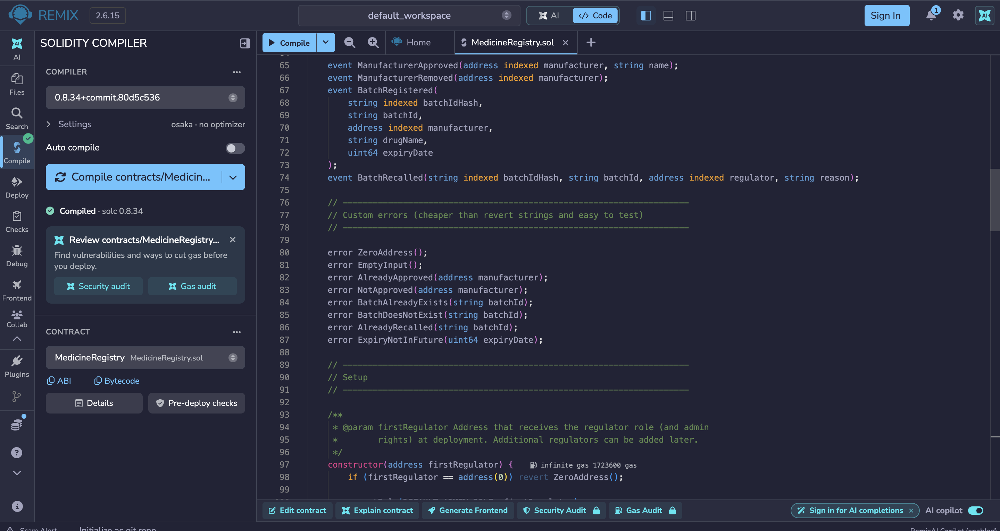

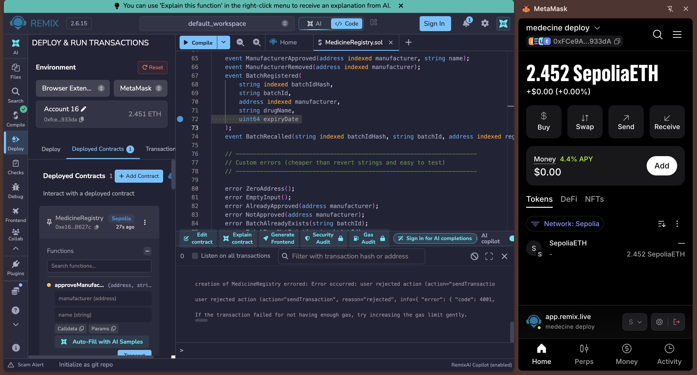

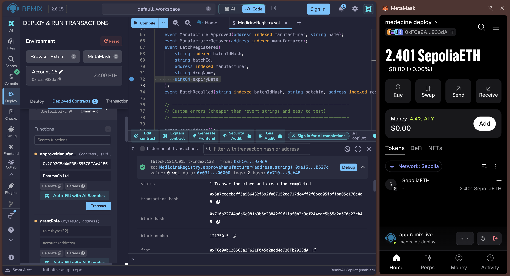

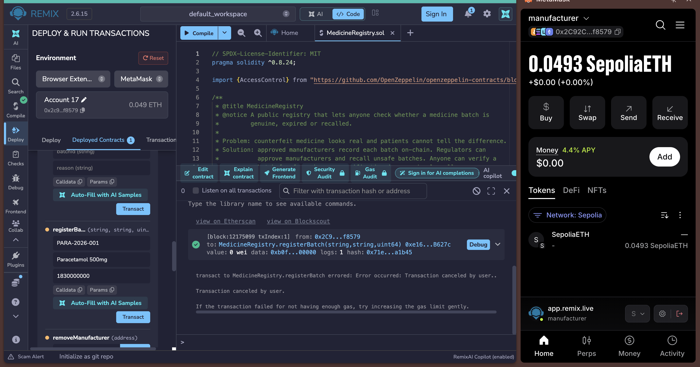

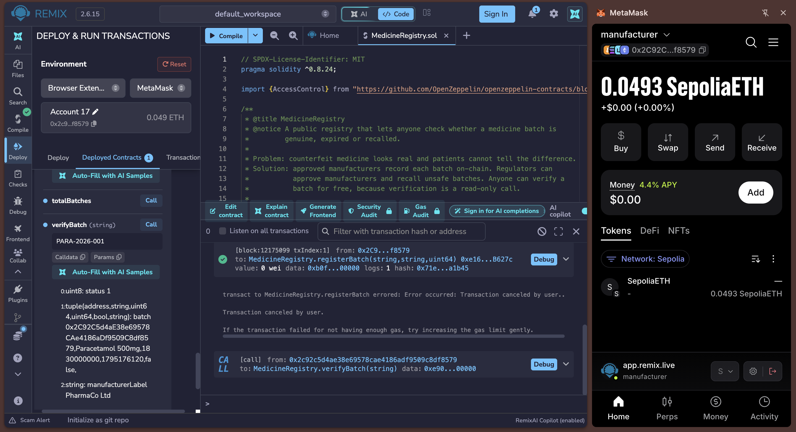

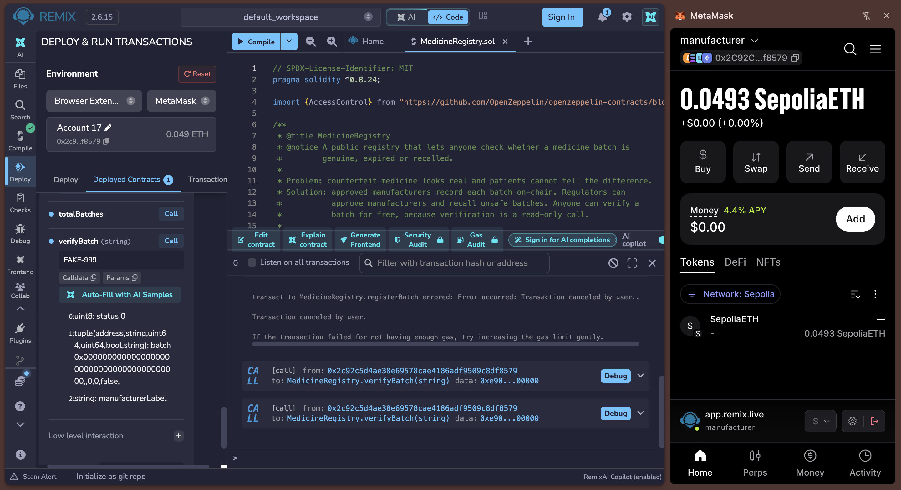

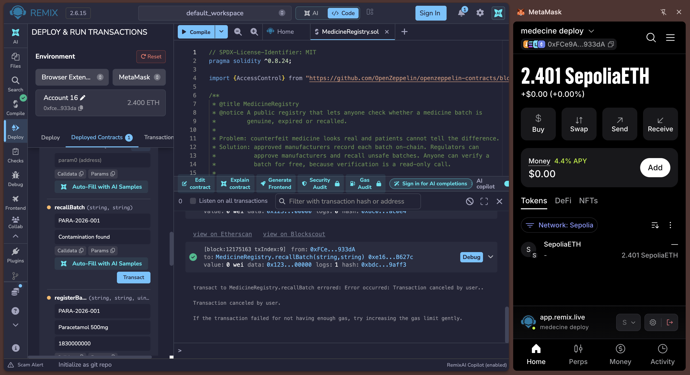

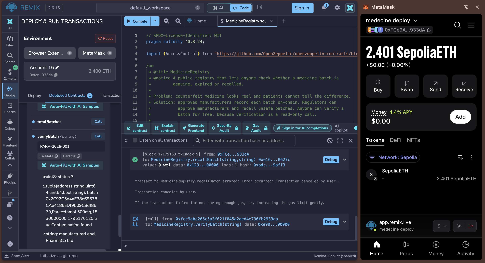

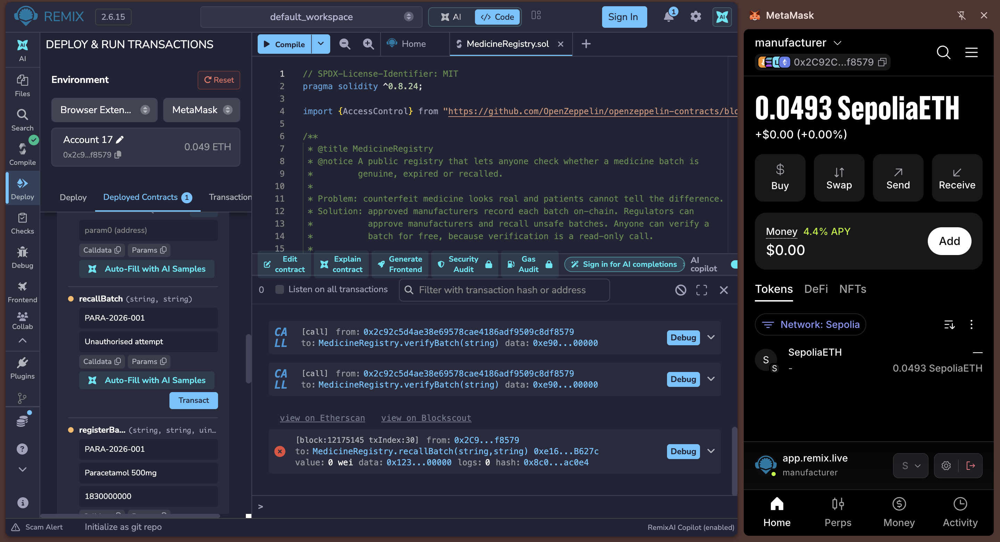

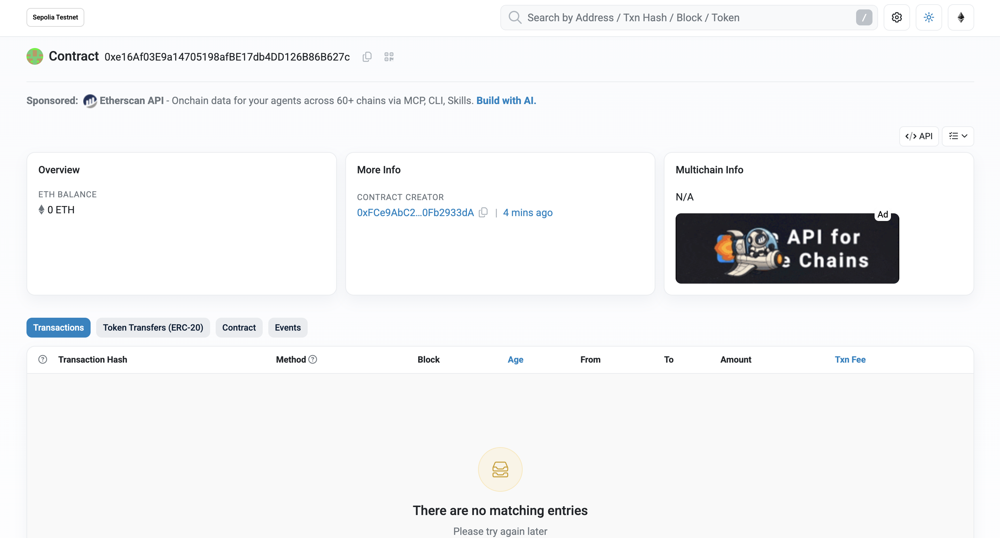

**Bonus: demo page.** To make the project easy to demonstrate, a small web page (`frontend/index.html`) lets a manufacturer register a batch, anyone check it, and a regulator recall it, all against the deployed Sepolia contract. Checking is a read-only call, so it is free and needs no wallet. Registering and recalling use MetaMask, and the contract's role checks still apply: a wallet that is not a regulator is refused when it tries to recall.

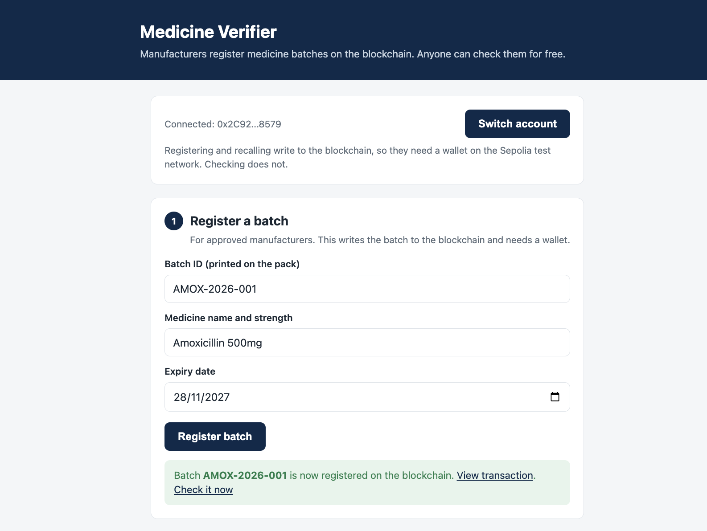

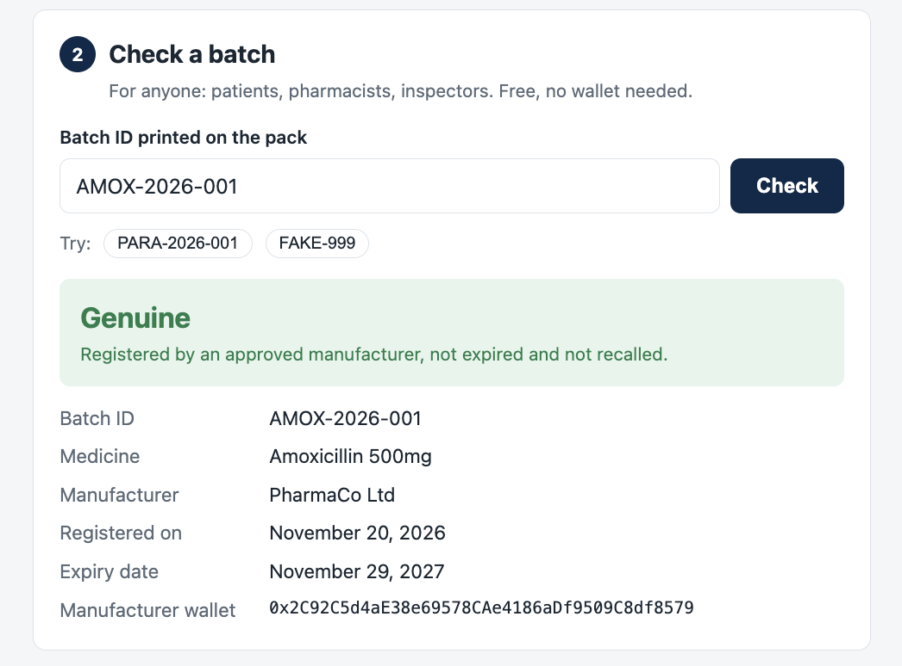

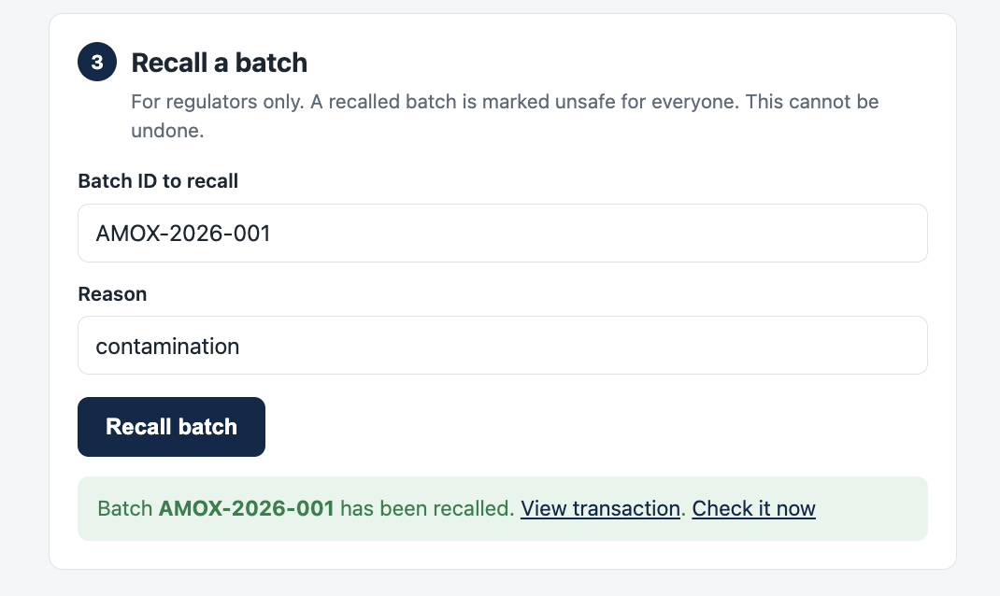

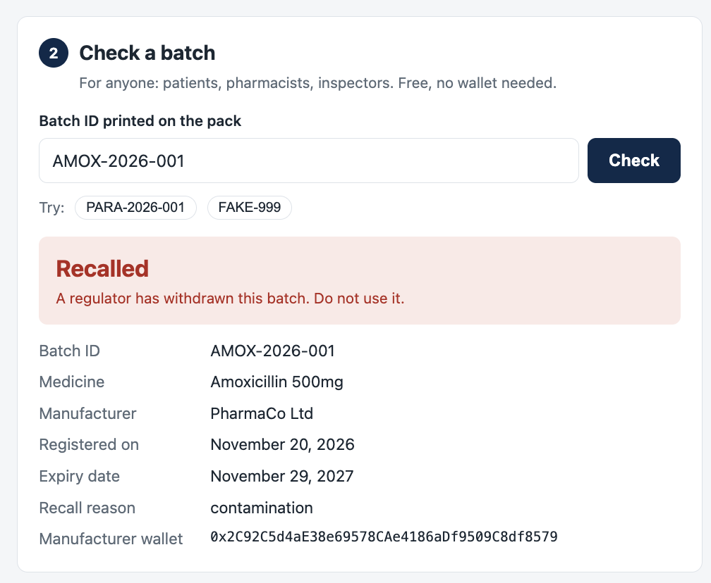

# 6. Validation and Testing

A Hardhat test suite of **22 test cases** was written in JavaScript (Mocha and Chai). Time-dependent behaviour such as expiry is tested by advancing the local blockchain clock. All 22 tests pass.

```
  MedicineRegistry
    Deployment
      ✔ T1 gives the first regulator the regulator role
      ✔ T2 rejects the zero address as first regulator
    Manufacturer approval
      ✔ T3 regulator approves a manufacturer and emits an event
      ✔ T4 non-regulator cannot approve a manufacturer
      ✔ T5 cannot approve the same manufacturer twice
      ✔ T6 regulator can remove a manufacturer, who then cannot register
      ✔ T7 removing someone who is not a manufacturer reverts
    Registering batches
      ✔ T8 approved manufacturer registers a batch
      ✔ T9 unapproved address cannot register a batch
      ✔ T10 duplicate batch ID is rejected
      ✔ T11 expiry date in the past is rejected
      ✔ T12 empty batch ID or drug name is rejected
    Verification
      ✔ T13 a registered batch verifies as Genuine with manufacturer details
      ✔ T14 an unknown batch ID returns NotFound
      ✔ T15 a batch past its expiry date returns Expired
      ✔ T16 anyone (even with no role) can verify
    Recalls
      ✔ T17 regulator recalls a batch and verification reports Recalled with the reason
      ✔ T18 non-regulator (even the manufacturer) cannot recall
      ✔ T19 cannot recall an unknown batch
      ✔ T20 cannot recall twice, and a reason is required
      ✔ T21 a recalled batch stays Recalled even after it expires
    Regulator management
      ✔ T22 a regulator can add another regulator; a stranger cannot


  22 passing (604ms)
```

The full table of expected versus actual results is in *Test Cases* (`docs/TEST_CASES.md`). The tests cover: deployment, manufacturer approval and removal, batch registration with all rejection paths, verification (genuine, unknown, expired, no-role caller), recalls (including priority over expiry), and regulator management. Seven additional manual tests (S1 to S7) were run on Sepolia and are recorded in the same table.

# 7. Limitations and Future Work
- **The registry verifies records, not the physical package.** A counterfeiter could copy a real batch ID onto fake packs. Future versions should use a unique serial per package or per-pack cryptographic codes.
- **Trust in the regulator and manufacturers' honesty at registration.** The blockchain guarantees records are not altered later; it cannot prove a manufacturer entered true data. Regulator approval is the control for this.
- **Regulator key security.** A multi-signature regulator account would reduce key-compromise risk.
- **Usability.** A phone-friendly QR scanner and web page would make verification accessible to ordinary patients.
- **Real deployment** would use a low-fee network and a legally recognised regulator.

# 8. Conclusion
MedicineRegistry gives patients and pharmacists a free, tamper-proof way to check that a medicine batch is genuine. It demonstrates role-based access control, a verifiable audit trail, thorough input validation and a complete test suite, and it was deployed and exercised on the Ethereum Sepolia testnet. It directly supports the mission of replacing blind trust with verifiable transparency in healthcare.

# Appendix: Project files
`contracts/MedicineRegistry.sol`, `remix/MedicineRegistry.sol`, `test/MedicineRegistry.test.js`, `scripts/deploy.js`, `scripts/interact.js`, `docs/DEPLOYMENT_GUIDE.md`, `docs/TEST_CASES.md`, `docs/test-output.txt`.
